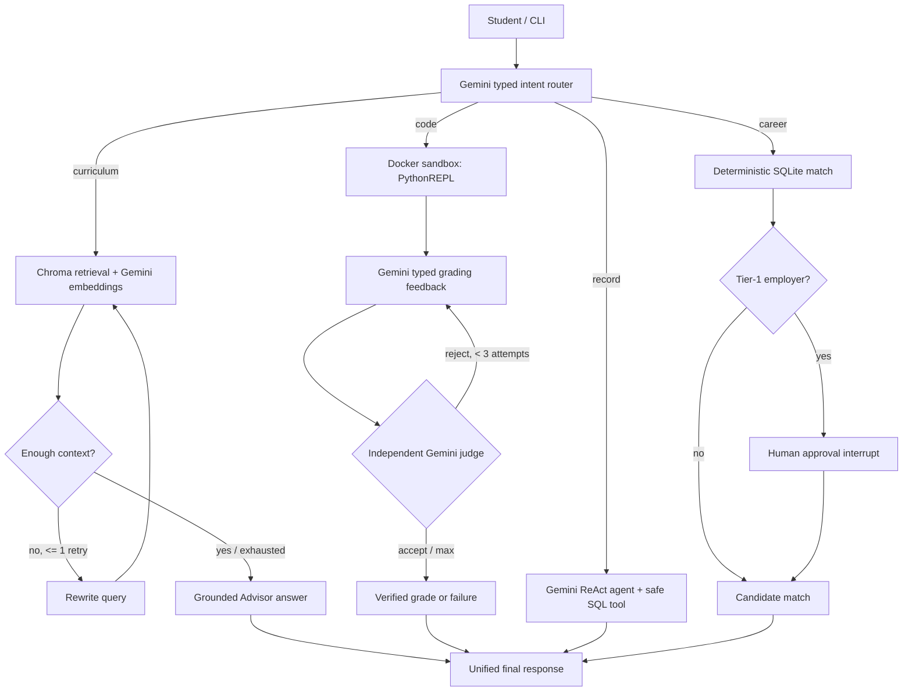

# Sprints Agentic Orchestrator

A LangGraph and Gemini demo for curriculum Q&A, Python assessment, learner records, and career matching.

## Demo data

The repository uses 25 synthetic learner records, synthetic curriculum text, and fictional job openings. Run `python -m src.main init` to generate the local SQLite database from the demo CSV.

## Architecture



Each conversation uses a `thread_id` derived from its learner ID, backed by `InMemorySaver` (the modern implementation of `MemorySaver`) within a single process. `HumanMessage`, `AIMessage` and `ToolMessage` trace worker communication. This is **not** security isolation by itself: authenticate each learner and authorize every thread ID for production.

## Requirements

- Python 3.11+ and a Gemini API key with access to the configured text/embedding models
- Docker Engine/CLI to grade student code. **There is no host execution fallback.**
- Network access for pip packages and Gemini embeddings/chat requests

## Windows PowerShell setup

```powershell
git clone https://github.com/amr-ai/sprints-agentic-orchestrator-.git
cd sprints-agentic-orchestrator-
py -3.11 -m venv .venv
.\.venv\Scripts\Activate.ps1
pip install -r requirements.txt
Copy-Item .env.example .env
# Set GOOGLE_API_KEY in .env; change GEMINI_MODEL if your account uses another model.
python -m src.main init
python -m src.main ingest
# In another shell, with Docker Desktop running:
docker build -f infra/Dockerfile.sandbox -t sprints-python-sandbox:local .
python -m src.main seed-demo-jobs
python -m src.main shell --learner SPR-1001
```

## Linux/macOS setup

```bash
git clone https://github.com/amr-ai/sprints-agentic-orchestrator-.git
cd sprints-agentic-orchestrator-
python3 -m venv .venv && source .venv/bin/activate
pip install -r requirements.txt
cp .env.example .env
# Fill GOOGLE_API_KEY in .env
docker build -f infra/Dockerfile.sandbox -t sprints-python-sandbox:local .
python -m src.main init
python -m src.main ingest
python -m src.main seed-demo-jobs   # optional fictional demo vacancies
python -m src.main shell --learner SPR-1001
```

## Three demo paths

1. **Curriculum:** Ask `Explain how StateGraph routes Advisor and Assessor agents.`. The bundled source is synthetic; the answer must reveal the fixture is not official Sprints curriculum.
2. **Assessment:** Enter `/code data/demo_submission.py sum_two`. Grading is blocked without the Docker image. No code runs on the host. The assessor emits Pydantic `score`, `feedback_points`, `pass_status` and an independent judge reviews up to **three** attempts.
3. **Career:** Ask `Can you match me to an employer?`. The fictional Fawry sample should trigger a LangGraph `interrupt` requiring reviewer approval. Even with approval the output says **DEMO MATCH ONLY**, not a verified vacancy.

## Security notes

- Docker runner uses `--network none`, `--read-only`, `--cap-drop=ALL`, `no-new-privileges`, nonroot UID, no bind mounts, CPU/memory/PID/file-descriptor budgets, and an execution timeout. This is defense-in-depth for a demo, **not** a complete adversarial-code isolation guarantee. Deploy gVisor/Firecracker or an equivalent dedicated untrusted-code execution platform with cgroup limits, orphan cleanup, output quotas and vulnerability review before any real learner submissions.
- Only parameterized, read-only SQL lookup tools are exposed; the LLM cannot compose SQL statements.
- Grading tests in `data/rubrics/assignments.json` are public demo cases. They are not cheat-resistant production assessments. Use hidden tests and a trusted independent grading worker for real exams.
- Missing SQLite, Docker, Chroma, Gemini, or human approval never silently becomes a verified answer or placement.
- The local approval prompt simulates reviewer identity; replace with verified staff authentication and an audited approval service.

## Measuring Chroma acceptance latency

The console prints latency from `search_curriculum`, which **includes the Gemini query-embedding API call**. The 1000-ms acceptance target has not been demonstrated; benchmark p50/p95 on the deployment environment with repeated warm queries, rate limits, dataset scaling and separate local vector search timings. No performance result is invented here.

## Limitations and upgrade path

- `InMemorySaver` forgets memory when the Python process ends: use `langgraph-checkpoint-sqlite`/Postgres for restart durability, while preserving explicit `thread_id` isolation.
- No learner authentication/API service yet; shell is a local exercise.
- Data only covers progress, track, assessment score, salary target and employer preferences. Fine-grained CV skills, availability, recruiter validation and real job descriptions are unavailable; do not infer them.
- Curriculum ingestion currently accepts `.md`/`.txt` only; convert/validate PDF material before indexing.
- Tools are synchronous; add observability, cost budgets, retry strategies, concurrent load tests, and access control before launch.
- `langchain-experimental` PythonREPL is **archived**, retained here only because the assignment explicitly requires a Python REPL utility. It is run only in an isolated container, never in the API process. Prefer a maintained grader runner in production.

## Submission and evaluation

Run `python -m pytest -q`. Offline tests check database ingestion, SQL safety, matching constraints, grading fail-closed behavior, schema enforcement, bounded judge loops and tier-1 routing. **Actual Gemini and Docker execution are not validated by offline tests.**

- `docs/demo_walkthrough_script.md`: directions for recording the required 3-5 minute MP4; the MP4 itself is **not included**.
- `docs/project_charter.md`: discovery deliverable.

## Official technical references

- [LangChain Gemini integration](https://reference.langchain.com/python/langchain-google-genai/chat_models/ChatGoogleGenerativeAI)
- [LangGraph HITL interrupts](https://docs.langchain.com/oss/python/langgraph/interrupts)
- [Chroma LangChain integration](https://docs.langchain.com/oss/python/integrations/vectorstores/chroma)
- [LangChain agent API](https://docs.langchain.com/oss/python/langchain/agents)
