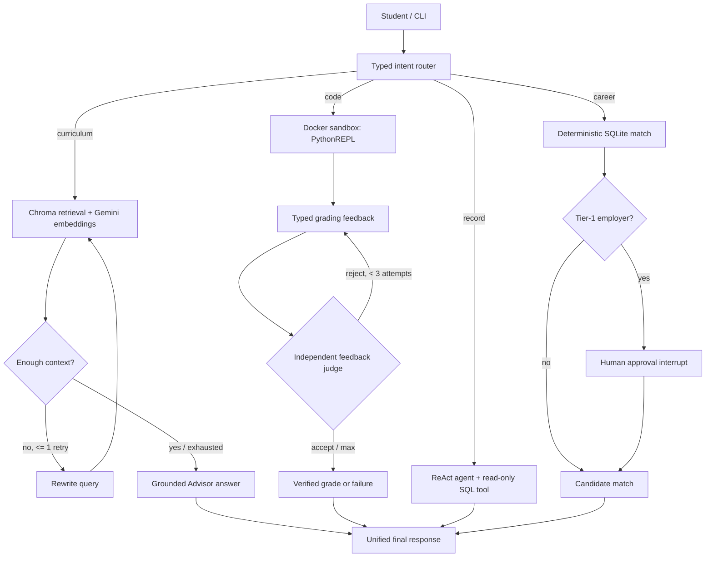

# Sprints Multi-Agent AI Career & Assessment Orchestrator

Local MVP based on the Sprints kickoff deck, discovery call, and learner CSV. The current demo uses Groq `openai/gpt-oss-120b` for chat and Gemini `gemini-embedding-001` for Chroma retrieval. The same learner session verified curriculum Q&A, Docker grading, tier-1 approval, and a read-only learner lookup. [Verification status](docs/verification_status.md)

## Important data quality disclosure

This public repository includes a 25-row anonymized learner fixture. The narrated walkthrough uses a captured local demo run with the learner name redacted.

The supplied learner CSV has **25 records**, not the 500 described in the project brief. The upload did not include official curriculum documents, a live job-opening feed, or the optional starter repository URL. To allow an honest demo, this project includes clearly labeled **synthetic curriculum text** and **fictional job-opening fixtures**. No real Fawry, Swvl or e& Egypt vacancy is claimed. Replace these before pitching a live deployment.

## Architecture



Each conversation uses a `thread_id` derived from its learner ID, backed by `InMemorySaver` (the modern implementation of `MemorySaver`) within a single process. `HumanMessage`, `AIMessage` and `ToolMessage` trace worker communication. This is **not** security isolation by itself: authenticate each learner and authorize every thread ID for production.

## Requirements

- Python 3.11+, `GROQ_API_KEY` for chat, and `GOOGLE_API_KEY` for curriculum embeddings. The application and `.env.example` default to `CHAT_PROVIDER=groq`, `GROQ_MODEL=openai/gpt-oss-120b`, and `GEMINI_EMBEDDING_MODEL=gemini-embedding-001`.
- Set `CHAT_PROVIDER=gemini` to use Gemini for chat. That provider defaults to `GEMINI_MODEL=gemini-3.5-flash-lite`.
- Docker Engine/CLI grades student code inside an isolated container. The demo configuration allows 40 seconds, including startup, via `DOCKER_SANDBOX_TIMEOUT_SECONDS`.
- Network access for pip packages, chat, and embeddings.

## Windows PowerShell setup

Extract the ZIP, open PowerShell in the extracted `sprints-ai-orchestrator` folder, and start Docker Desktop. For a new Python environment, run:

```powershell
py -3 -m venv .venv
.\.venv\Scripts\python.exe -m pip install -r requirements.txt
if (!(Test-Path .env)) { Copy-Item .env.example .env }
notepad .env
```

Set `GROQ_API_KEY` and `GOOGLE_API_KEY` in `.env` and save. If the sandbox image is already built, continue from `init`.

```powershell
docker build -f infra/Dockerfile.sandbox -t sprints-python-sandbox:local .
.\.venv\Scripts\python.exe -m src.main init
.\.venv\Scripts\python.exe -m src.main ingest
.\.venv\Scripts\python.exe -m src.main seed-demo-jobs
.\.venv\Scripts\python.exe -m pytest -q
.\.venv\Scripts\python.exe -m src.main shell --learner SPR-1001
```

## Linux/macOS setup

```bash
cd sprints-ai-orchestrator
python3 -m venv .venv && source .venv/bin/activate
pip install -r requirements.txt
test -f .env || cp .env.example .env
# Fill GROQ_API_KEY and GOOGLE_API_KEY in .env
docker build -f infra/Dockerfile.sandbox -t sprints-python-sandbox:local .
python -m src.main init
python -m src.main ingest
python -m src.main seed-demo-jobs   # optional fictional demo vacancies
python -m src.main shell --learner SPR-1001
```

## Three demo paths

1. **Curriculum:** Ask `Explain how StateGraph routes Advisor and Assessor agents.`. The bundled source is synthetic; the answer must reveal the fixture is not official Sprints curriculum.
2. **Assessment:** Enter `/code data/demo_submission.py sum_two`. Grading is blocked without the Docker image. No code runs on the host. The assessor emits Pydantic `score`, `feedback_points`, `pass_status` and an independent judge reviews up to **three** attempts.
3. **Career:** Ask `Can you match me to a job opening with an employer?`. The fictional Fawry sample triggers a LangGraph `interrupt` requiring reviewer approval. The resumed response labels the opening **DEMO MATCH ONLY**.

For the learner record, ask `What are my completed modules, salary target, and preferred employers?`. The CLI logs the ReAct tool trace and returns the verified fields from SQLite. If a provider returns HTTP 429, follow the retry information in its response.

## Security notes

- Docker runner uses `--network none`, `--read-only`, `--cap-drop=ALL`, `no-new-privileges`, nonroot UID, no bind mounts, CPU/memory/PID/file-descriptor budgets, and an execution timeout. This is defense-in-depth for a demo, **not** a complete adversarial-code isolation guarantee. Deploy gVisor/Firecracker or an equivalent dedicated untrusted-code execution platform with cgroup limits, orphan cleanup, output quotas and vulnerability review before any real learner submissions.
- Only parameterized, read-only SQL lookup tools are exposed; the LLM cannot compose SQL statements.
- Grading tests in `data/rubrics/assignments.json` are public demo cases. They are not cheat-resistant production assessments. Use hidden tests and a trusted independent grading worker for real exams.
- SQLite, Docker, Chroma, or provider failures produce a structured verification failure. Tier-1 placement requires human approval.
- The local approval prompt simulates reviewer identity; replace with verified staff authentication and an audited approval service.

## Measuring Chroma acceptance latency

The console prints the latest search time from the current Advisor turn. It includes opening the vector store, a Gemini query embedding, and the Chroma search. Timing resets at the start of every turn, including when grading follows an Advisor answer on the same learner thread. The recorded full retrieval exceeded the 1,000 ms target. The verification notes include the current reading and the earlier warm Chroma benchmark. [Recorded measurements](docs/verification_status.md#retrieval-latency)

## Limitations and upgrade path

- `InMemorySaver` forgets memory when the Python process ends: use `langgraph-checkpoint-sqlite`/Postgres for restart durability, while preserving explicit `thread_id` isolation.
- No learner authentication/API service yet; shell is a local exercise.
- Data only covers progress, track, assessment score, salary target and employer preferences. Fine-grained CV skills, availability, recruiter validation and real job descriptions are unavailable; do not infer them.
- Curriculum ingestion currently accepts `.md`/`.txt` only; convert/validate PDF material before indexing.
- Tools are synchronous; add observability, cost budgets, retry strategies, concurrent load tests, and access control before launch.
- `langchain-experimental` PythonREPL is **archived**, retained here only because the assignment explicitly requires a Python REPL utility. It is run only in an isolated container, never in the API process. Prefer a maintained grader runner in production.

## Submission and evaluation

Run `python -m pytest -q`. The 12 offline tests cover CSV ingestion, SQL safety, matching constraints, grading failure without Docker, typed feedback, bounded loops, tier-1 routing, and retrieval timing across consecutive turns.

- `docs/technical_report.pdf` and `docs/final_presentation.pptx` / `.pdf`: technical report and nine stakeholder slides covering the current Groq demo.
- `notebooks/evaluator_optimizer_loop.ipynb`: local notebook with observed (offline) outputs.
- [3:31 narrated walkthrough MP4](docs/sprints_narrated_walkthrough.mp4) and [narration script](docs/demo_walkthrough_script.md). The video replays captured CLI output from the current Groq demo with English narration.
- `docs/project_charter.md`: discovery deliverable.

## Official technical references

- [LangChain Gemini integration](https://reference.langchain.com/python/langchain-google-genai/chat_models/ChatGoogleGenerativeAI)
- [LangChain Groq integration](https://docs.langchain.com/oss/python/integrations/chat/groq)
- [LangGraph HITL interrupts](https://docs.langchain.com/oss/python/langgraph/interrupts)
- [Chroma LangChain integration](https://docs.langchain.com/oss/python/integrations/vectorstores/chroma)
- [LangChain agent API](https://docs.langchain.com/oss/python/langchain/agents)
